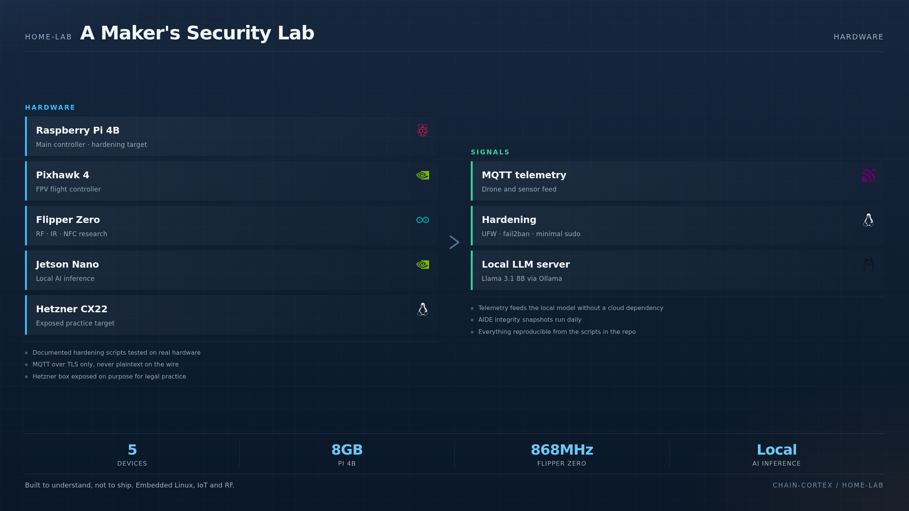

<div align="center">

# 🏠 home-lab — A Maker's Security Lab

**Raspberry Pi, drones, Flipper Zero, MQTT, and a local AI server.**

[](https://www.raspberrypi.com)
[](https://www.linux.org)
[](LICENSE)

**Where cybersecurity meets maker culture.**

</div>


---

<p align="center">
  
</p>

### What lives in the lab

A personal hardware lab for understanding embedded Linux, IoT and radio. The **Raspberry Pi 4B** is the main controller and the primary hardening target — SSH is key-only, root login is off, UFW is default-deny and fail2ban watches the logs. A **Pixhawk 4** flies the drones, a **Flipper Zero** handles RF/IR/NFC research and a **Jetson Nano** runs local AI inference. Telemetry travels over **MQTT with TLS only**. A **Hetzner CX22** is deliberately exposed as a legal practice target, and the whole stack runs behind a local **Llama 3.1 8B** served by Ollama.

---

## 🎯 What is this?

This is a **personal homelab** where I document my experiments with embedded Linux, IoT, drone telemetry, radio frequency, and self-hosted AI. It's the "maker" side of my profile — the things I build to **understand** rather than to ship.

The lab runs on:

- **Raspberry Pi 4B (8GB)** — main controller, hardening target
- **Pixhawk 4** — flight controller for FPV drones
- **Flipper Zero** — RF/IR/NFC research
- **Nvidia Jetson Nano** — local AI inference
- **Hetzner CX22 VPS** — exposed services for legal pentesting practice
- **Local LLM server** — Ollama + Llama 3.1 8B for private AI

---

## 🧪 Projects in this repo

### 1. `raspberry-pi-hardening/` — Securing the Pi

**Goal:** Turn a default Raspberry Pi OS install into a hardened target.

```bash
# After fresh install, run this script
sudo ./harden.sh
```

What it does:
- Disables root login via SSH
- Enforces key-only SSH auth
- Sets up UFW firewall with default-deny
- Configures fail2ban with custom rules
- Enables auditd with sensible watch list
- Disables unnecessary services (Bluetooth if not used, etc.)
- Sets up automatic security updates
- Configures `sysctl` hardening (no source routing, no ICMP redirects)
- Daily AIDE (file integrity) snapshots

**Tested on:** Raspberry Pi OS 12 (Bookworm) on Pi 4B

### 2. `mqtt-telemetry/` — Secure MQTT for IoT

**Goal:** Build a hardened MQTT broker for drone telemetry.

```yaml
# docker-compose.yml excerpt
services:
  mosquitto:
    image: eclipse-mosquitto:2.0
    ports:
      - "8883:8883"  # TLS only
    volumes:
      - ./mosquitto/config:/mosquitto/config
      - ./mosquitto/data:/mosquitto/data
      - ./mosquitto/log:/mosquitto/log
    command: mosquitto -c /mosquitto/config/mosquitto.conf
```

**Features:**
- TLS 1.3 only
- Client certificate auth (mutual TLS)
- ACL per device (each drone can only publish to its own topic)
- Persistent sessions for reliable telemetry
- Prometheus exporter for monitoring

### 3. `flipper-zero/` — RF Research Notes

My collection of safe, **legal** Flipper Zero experiments:

- Sub-GHz frequency analysis (RX only, no TX)
- NFC/RFID tag reading (passive)
- IR signal capture and replay for legacy devices
- Bad USB payload testing (with rubber ducky-style scripts)
- GPIO pin experiments with custom PCBs

**⚠️ All experiments use RX-only mode for RF. TX is disabled in firmware.**

### 4. `ollama-server/` — Local AI Inference

**Goal:** Run Llama 3.1 8B locally with privacy guarantees.

```bash
# Quickstart
docker run -d --name ollama \
  --gpus all \
  -v ollama_data:/root/.ollama \
  -p 11434:11434 \
  ollama/ollama

# Pull a model
docker exec ollama ollama pull llama3.1:8b

# Chat
curl http://localhost:11434/api/generate -d '{
  "model": "llama3.1:8b",
  "prompt": "Explain the reentrancy vulnerability in Solidity"
}'
```

**Features:**
- OpenAI-compatible API at `localhost:11434`
- No telemetry, no data leaves the host
- Models: Llama 3.1, Mistral, Phi-3, CodeLlama
- Web UI via Open WebUI (separate docker-compose)
- Used as one of the backends for **ChainGuard.ai's Hydra orchestrator**

### 5. `drone-telemetry/` — MAVLink Analysis

**Goal:** Capture and analyze MAVLink traffic from ArduPilot drones.

Tools:
- `mavproxy` for ground station
- Wireshark with MAVLink dissector
- Custom Python script to log GPS, attitude, battery
- Anomaly detection on the telemetry stream (e.g., GPS suddenly jumping = possible spoofing)

**Use case:** Research on drone security and GPS spoofing detection.

### 6. `pentest-targets/` — Local Vulnerable VMs

**Goal:** Local vulnerable targets for legal practice.

- DVWA (Damn Vulnerable Web App)
- Metasploitable 3
- VulnHub boxes downloaded to local VM
- Each VM isolated on its own VLAN

**All in compliance with E-Education fair use, no internet exposure.**

---

## 🛠️ Hardware

| Device | Purpose | Notes |
|---|---|---|
| Raspberry Pi 4B (8GB) | Main controller, hardening target | PoE+ HAT for clean power |
| Pixhawk 4 | Flight controller for FPV drones | ArduPilot firmware |
| Flipper Zero | RF/IR/NFC research | Firmware locked to RX-only for RF |
| Nvidia Jetson Nano | Local AI inference | 4GB, learning CUDA |
| Hetzner CX22 VPS | Exposed services | 4€/month, 2 vCPU, 4GB RAM |
| Local desktop (RHCSA host) | Main dev machine | Fedora Workstation |
| USB RTL-SDR | RF signal capture | For Flipper experiments |
| Logic analyzer | GPIO debugging | Saleae clone |

---

## 🎓 What I learned

- **Linux hardening is not magic** — it's a series of small, deliberate decisions
- **MQTT with mutual TLS is a real production pattern** — used in industrial IoT
- **Local LLMs are usable today** — Llama 3.1 8B is fine for code analysis, smart enough for security tooling
- **Hardware is humbling** — the same bug in firmware vs software has very different consequences
- **Documentation is the deliverable** — code without notes is just artifacts

---

## 🛣️ Roadmap

- [ ] Add `cuckoo-sandbox` for malware analysis
- [ ] Set up a `burp-collaborator` alternative for private bug bounty practice
- [ ] Document a full home SOC stack (Wazuh + Velociraptor)
- [ ] Build a custom PCB for drone GPS spoofing detection

---

## ⚖️ Legal

All experiments are conducted in **isolated lab environments**. No traffic is sent to systems I don't own. Flipper Zero is used in **RX-only mode** for RF experiments to comply with local regulations.

See [docs/legal-notice.md](docs/legal-notice.md) for full disclaimer.

---

## 📜 License

MIT © 2026 Santiago López Castaño.

## 📫 Contact

- GitHub: [@santilpz28](https://github.com/santilpz28)
- LinkedIn: [santiagolopez-cyber](https://www.linkedin.com/in/santiagolopez-cyber/)
- Email: santi.lpz28@gmail.com
- Portfolio: [santilpz28.github.io/chainguard-pages](https://santilpz28.github.io/chainguard-pages/)
